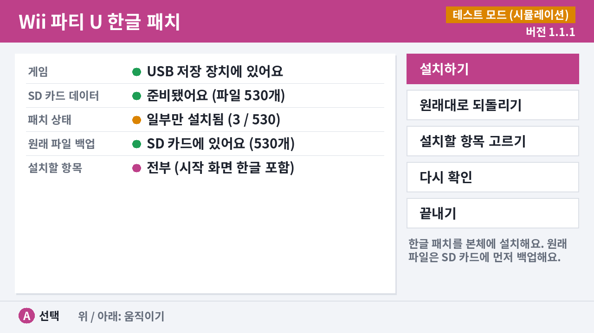

# Wii 파티 U 한글 패치

일본판 ANXJ01 (타이틀 ID `000500001011A800`)을 위한 팬 한글 패치입니다.

## 설치

[릴리스 다운로드](https://github.com/auseong325-design/wii-party-u-korean-patch/releases/latest)에서 Wii U용 또는 Cemu용 ZIP을 받아 압축을 풀고, 안에 있는 `설치 안내.txt`를 따라 주세요. Wii U용은 Aroma와 SD 카드가 필요합니다.

이전 버전을 본체에 설치했다면 기존 설치 도구와 백업으로 원래 상태로 되돌린 후 새 버전을 설치하세요.

## 구성과 출처

설치 도구와 포함된 글꼴 구성 요소의 소스 및 라이선스 고지는 배포 ZIP에 포함되어 있습니다. 게임 원본과 업데이트는 별도로 필요합니다.
